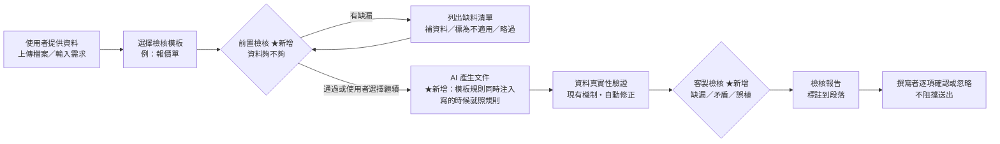
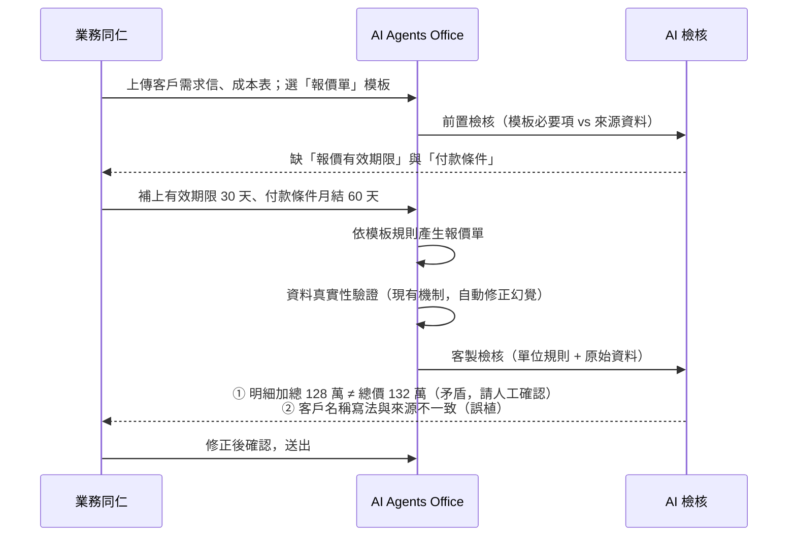

# AI Agents Office — 文件客製化自動審查 產品需求文件

> 版本：1.1｜日期：2026-10-19｜
>
> **v1.1 修訂**（依客戶回覆調整）：①「模板移轉」開放給檢閱者（第 5 節）②「擁有者移轉」納入變更軌跡（6.4）③「預設檢核項目」維護開放給檢閱者（第 5 節）④ 新增跨部門共用規則的處理方式：**複本轉移**（6.1.1，建議方案）

---

## 1. 模組簡介

### 系統現有功能

AI Agents Office 目前**已內建一道自動驗證**：文件產生後、呈現給使用者之前，系統會把產出內容與使用者提供的資料逐項比對，找出**來源資料裡沒有、也推導不出來的公司名、客戶名、人名與數字**（也就是 AI 的「幻覺」），發現後**自動修正再呈現**，使用者不需要自己抓。

這道驗證的特性是：**系統固定、自動修正、使用者無感**。它回答的問題是——「**AI 有沒有亂寫**」。

### 本模組核心

它回答不了另一個問題：「**這份文件符不符合我們單位的規矩**」。因為檢查什麼是寫死在系統裡的，各單位無法把自己的審查重點加進去。

**文件客製化自動審查**讓各單位把自己的審查標準寫成一份「**檢核模板**」，並在既有驗證之外，補上兩件目前做不到的事：

- **產文件前的檢核**：先比對「這份模板需要哪些資訊」與「你給了哪些資料」，把**缺的項目**先講清楚，讓使用者補齊再產——而不是產完才發現這份不能用。
- **產文件後的客製檢核**：除了現有的防幻覺驗證，再依單位自訂的規則檢查**缺漏、內容矛盾、專有名詞誤植**，標註在對應段落，**呈現給撰寫者確認或忽略**，而不是由系統自己默默改掉。

一句話：**把現有的「系統防幻覺」，擴充為「單位可自訂、產前產後都管、且由人做最後判斷」的審查機制。**

> **設計原則：提示而非攔阻。** 客製規則的判斷不像防幻覺那樣有明確對錯，AI 可能誤報，因此檢核結果一律以提示呈現，最終決定權在撰寫者手上（對應需求說明第 6 點）。

---

## 2. 現況能力與本次擴充

| 面向 | 現況（已上線） | 本次擴充 |
|------|----------------|----------|
| **檢查什麼** | AI 有沒有寫出來源資料沒有的數據與名稱（防幻覺） | 加上**各單位自訂**的審查項目：必要要素、章節架構、格式、專有名詞、數值規則 |
| **規則由誰定** | 系統固定，無法調整 | **各單位自行定義與維護**，不需為個別需求逐案開發 |
| **什麼時候檢查** | 只在**產出後** | 產出後 **＋ 產出前**（先檢查資料夠不夠） |
| **對產出的影響** | 系統自動修正，使用者無感 | 產出時**規則一併注入**，讓 AI 一開始就照規矩寫 |
| **結果怎麼呈現** | 不呈現（內部自動處理） | 逐項列出、**標註到段落**、由撰寫者確認或忽略，並留下處置紀錄 |
| **適用範圍** | 全系統一致 | 依 **AD 部門**分別套用，一個部門可有多組模板 |

> 現有的防幻覺驗證**維持不變並繼續運作**；本模組是在其之上疊加，兩者互補，不重疊、不取代。

---

## 3. 痛點與對應

| # | 客戶痛點 | 本模組如何解決 |
|---|----------|----------------|
| 1 | 現行檢核規則為系統固定項目，各單位無法自行定義要檢查的內容 | 把「檢查什麼」從系統寫死改為**單位可維護的模板**，各單位在自己的模板庫建立檢核項目，**不需為個別需求逐案開發** |
| 2 | 各單位報告格式與審查重點不同，統一標準無法涵蓋 | 模板以 **AD 部門**為範圍管理，一個部門可有多組模板（報價單、月報、驗收報告…），互不干擾 |
| 3 | 系統未涵蓋的檢查項目，仍倚賴主管人工審閱 | 六類檢核項目涵蓋格式、章節、必要要素、專有名詞、數值規則與自由描述規則，主管的審查重點可直接寫成規則 |
| 4 | 專有名詞誤植與內容矛盾須逐段比對，人工不易察覺 | AI 逐段比對原始資料與產出文件，指出誤植的正確寫法與矛盾所在段落，並標註定位供人工確認 |

---

## 4. 名詞定義

| 名詞 | 說明 |
|------|------|
| **模板庫** | 以 **AD 部門**為範圍的檢核模板集合；模板由建立者維護，並可設為僅自己使用或部門共用 |
| **檢核模板** | 對應**單一文件格式**的審查標準，例如「報價單模板（簡報）」「月報模板（Word）」；包含多個檢核項目 |
| **預設檢核項目** | 系統內建的一組**常見檢核規則**（例如「須有總金額」「明細加總須等於總計」），建立模板時可直接挑選帶入再修改，不必從零打字。帶入後即成為你模板裡的規則，與系統預設不再連動。**這是規則的起點，不是文件版型**（文件版型是 6.2 的「模板樣張」）|
| **檢核項目** | 一條具體規則，例如「必須有報價總金額」「客戶名稱須為全名」 |
| **嚴重度** | 每條規則標示為**必要**或**建議**，決定提示的強度（皆不阻擋送出） |
| **前置檢核** | 產文件**之前**，比對來源資料是否足以滿足模板要求 |
| **客製檢核** | 產文件**之後**，依單位規則比對產出內容（有別於系統既有的防幻覺驗證） |
| **檢核報告** | 一次檢核的完整結果，逐項可展開、可定位到文件段落、可標記處置 |

---

## 5. 適用對象與權限

「單位」即 **AD 部門**，沿用現有的 AD 組織資料，不另建群組。

本模組**不新增任何系統角色**，沿用 AI Agents Office 現有的三種角色。其中**模板移轉**與**預設檢核項目維護**兩項管理作業，開放給檢閱者與管理員共同承擔——這兩件事都屬於日常營運（人員異動、規則增補），不宜集中到管理員一人身上造成等待：

| 現有角色 | 在本模組可做的事 |
|----------|------------------|
| **一般用戶** | 建立自己的檢核模板、決定要不要開放給部門；使用自己的與部門已開放的模板；查看檢核結果、補資料、逐項確認或忽略 |
| **檢閱者** | 一般用戶的所有操作，另可**維護系統的預設檢核項目**（新增／修改／停用，第 6.3 節 ① 的來源清單）；於人員離職或轉調時，**將模板移轉給部門內其他人接手**；可將成熟模板收錄為公司參考範本（6.1.1 ②） |
| **管理員** | 檢閱者的所有操作，差別在**不受部門範圍限制**（可跨部門處理模板移轉，例如整個部門裁撤或改組） |

---

## 6. 功能範圍

### 6.1 模板庫與可見範圍

- 模板庫以 **AD 部門**為範圍，成員只會看到自己的模板，以及所屬部門中設為共用的模板。
- **誰建立、誰維護**：建立模板的人就是該模板的擁有者，負責後續編輯與調整。
- 建立者可自行設定**可見範圍**：

| 可見範圍 | 誰看得到 | 適用情境 |
|----------|----------|----------|
| **僅自己** | 只有建立者 | 還在試調規則，或只是個人習慣用的檢核清單 |
| **部門共用** | 同一 AD 部門的所有成員 | 規則已成熟，要讓部門同仁一起沿用 |

- 可見範圍隨時可切換；不論是否開放，**管理權都留在建立者身上**（建立者離職或轉調時，由**檢閱者或管理員**將模板移轉給部門內其他人接手；移轉後新擁有者取得完整編輯權，模板規則與歷史版本一併帶過去，並留下移轉紀錄，見 6.4）。
- **可見範圍只有這兩層。** 不新增「開放給指定部門」或「全公司共用」的層級——跨部門**即時共用**會讓「誰維護、改了影響誰」失去界線。跨部門想用同一套規則，改以**複本轉移**處理，見 6.1.1。
- 一個人可建立多組模板，各自對應一種報告類型與一種文件格式（例如「報價單（簡報）」「報價單（Word）」為兩個獨立模板）。
- 模板可**停用**而不刪除（歷史文件的檢核紀錄保留）。
- 模板可**複製**後修改，作為建立新模板的起點。

### 6.1.1 兩個部門規則相同時，怎麼把模板給對方（複本轉移）

**原則：規則可以給，但不共用同一份模板。** 對方拿到的是一份屬於他自己部門的**複本**，自該刻起兩邊各自維護、互不影響。這樣既不用請對方重建，也不必開出「跨部門可見」的權限層。

| 方式 | 怎麼做 | 誰能做 | 適用情境 |
|------|--------|--------|----------|
| **① 站內分享複本**（建議主要做法） | 擁有者在模板上按「分享複本」，指定接收人（可跨部門），或產生一組分享碼交給對方；對方在自己的模板庫按「接收」後，即成為他部門的新模板，擁有者換成接收人，版本從 v1 重新起算 | 模板擁有者（接收端需同意） | 兩個部門規則相同或接近，對方想直接沿用再微調 |
| **② 公司參考範本庫**（建議併做） | 檢閱者／管理員把已成熟的模板**收錄**為「公司參考範本」，全公司看得到但**唯讀、不能直接拿來產文件**；任何人可按「複製到我的模板庫」後自行修改 | 收錄：檢閱者／管理員 複製：所有人 | 報價單、驗收報告這類已是公司通用做法的規則，不必每個部門從零建立 |
| **③ 檔案匯出／匯入**（選配，後續再做） | 模板規則匯出成一個檔案，對方匯入；樣張檔一併打包 | 匯出：擁有者 匯入：所有人 | 跨環境搬移（內網／外網兩套系統）、離線備份 |

- 三者結果一致：**一次性複製、不連動。** 來源模板日後修改不會同步到複本，複本修改也不會回寫來源；要不要跟進對方的調整，由各部門自己決定。
- 複本會記錄**來源出處**（例如「複製自：業務部／報價單 v4」），日後要比對兩邊規則差異時有跡可循。
- 分享、接收、收錄、匯出等動作都寫入變更軌跡（誰、何時、給誰），見 6.4。
- 不新增角色，可見範圍仍只有 6.1 的兩層；③ 因為規則內容會以檔案形式離開系統（可能含客戶名稱、專有名詞對照），限擁有者本人操作並留存紀錄。

> **為什麼不做跨部門即時共用？** 一旦兩個部門指向同一份模板，A 部門改一條規則就會立刻改變 B 部門的檢核結果與歷史稽核基準，責任歸屬說不清；AD 部門本身也會因組織調整而變動。**複本模型**用「規則流通、維護權不流通」換掉這層複雜度。
>
> **落地建議**：① 為第一階段必做（成本最低、直接解決客戶問題）；② 隨後補上（讓公版規則有收斂的地方）；③ 待有內外網／跨環境需求時再做。

### 6.2 檢核模板編輯

模板設定包含：

| 欄位 | 說明 |
|------|------|
| 模板名稱 | 例：報價單、專案月報、驗收報告 |
| 文件格式 | Word／簡報／Excel／PDF **擇一**。一個模板只對應一種格式——簡報格式的報價單模板，只會在產簡報時套用 |
| 模板樣張（選填） | 上傳一份現有的該格式文件作為樣張。上傳後格式即由這份檔案決定，並供 AI 參考版面與寫法 |
| 說明 | 給成員看的用途說明 |
| 檢核項目 | 多筆規則，見 7. 檢核項目類型 |
| 產出指引（選填） | 一段給 AI 的補充說明，產文件時一併注入，讓 AI 一開始就照規則寫 |

> **關鍵設計：規則不只用來事後抓錯，也在產出時導引 AI。** 選定模板後，規則會同時進入產文件的指示中，能大幅降低事後檢核抓到問題的機率——這是「客製規則」相對於現有防幻覺驗證多出來的一項能力。

### 6.3 建立模板的三種方式

不必從一張白紙開始寫規則，可依手邊素材選擇起點：

| 方式 | 適用情境 | 操作 |
|------|----------|------|
| **① 從預設檢核項目挑選**（最常用） | 想快速開始 | 系統列出常見的檢核項目，**勾選要用的帶入模板後再修改**（改文字、調嚴重度、刪掉不需要的） |
| **② 由範例文件自動產生** | 手邊有現成的舊文件，但說不清楚「規矩」是什麼 | 上傳 1～3 份過去的同類文件，AI 讀完後**提出建議的檢核規則清單**，建立者**逐條確認、修改或刪除**後存成模板 |
| **③ 從零建立** | 需求特殊，沒有可參考的起點 | 直接新增規則 |

三種方式可混用：先勾一批預設項目，再讓 AI 從舊文件補幾條，最後自己加上單位特有的規矩。

**預設檢核項目**（系統內建，可持續增補）：

| 類型 | 內建的常見項目 |
|------|----------------|
| 必要要素 | 文件標題、日期、負責人／聯絡人、對象（客戶／單位）名稱、總金額、有效期限 |
| 數值規則 | 明細加總須等於總計、百分比合計須為 100%、數量不可為負 |
| 格式規則 | 金額須加千分位並標示幣別、日期格式須一致、單位標示須一致 |
| 專有名詞 | 公司名稱的正確寫法（強茂／PANJIT） |
| 內容完整性 | 不可留有「待補」「TBD」「XXX」等未完成的佔位文字 |

> **② 的定位是「AI 出草稿、人來定稿」**：AI 只提出建議，所有規則都必須經建立者確認才會生效，不會自動套用。這樣既省去「要自己把幾十條規矩打進系統」的功夫，也不會讓 AI 憑空決定審查標準。

### 6.4 模板版本控管與變更軌跡

- 每次修改模板會產生一個**新版本**，保留完整的規則內容。
- 變更軌跡記錄：**誰、在什麼時候、改了哪一條規則**（新增／修改／刪除，並可比對前後差異）。
- **擁有者的移轉也記在同一條軌跡上**：何時移轉、從誰移轉給誰、執行者是誰（檢閱者或管理員）、移轉事由（離職／轉調／組織調整／其他）。除移轉外，下列事件同樣入軌跡：可見範圍切換（僅自己 ↔ 部門共用）、模板停用與啟用、還原到舊版本、分享複本／接收複本／收錄為公司參考範本／匯出匯入（6.1.1）。
- 軌跡為**唯讀、不可刪改**，供日後稽核「這份文件當時是誰的標準、由誰把關」。
- 每份文件的檢核報告會記錄**當時套用的模板版本**——日後回頭稽核時，看到的是當時的標準，而不是被改過的現行標準。
- 可檢視歷史版本；必要時可將模板**還原**到某個舊版本。

### 6.5 產文件時選擇模板

- 在產文件的輸入區新增「檢核模板」選擇器（與現有的「資料源」選擇器並列）。
- 選單只列出**與本次要產的文件格式相符**的模板；選定模板後，輸出格式即隨模板走，不需再另外指定。
- 不選模板時，行為與現在完全相同（仍受既有的防幻覺驗證保護），不影響既有使用者。

### 6.6 前置檢核（產出前）★ 目前系統沒有

1. 系統抽取來源資料（上傳檔案內容＋使用者輸入的需求文字）。
2. AI 逐條比對模板的必要項目，判定**有／疑似有／沒有**，並附上判斷依據（引用來源片段）。
3. 以「缺料清單」呈現，每一項可：
   - **補資料**（直接輸入，或再上傳檔案）
   - **標為不適用**（本次不需要這一項，記錄原因）
   - **略過並繼續產出**（使用者仍握有最終決定權）
4. 補齊後重新檢核，通過即進入產文件。

### 6.7 客製檢核（產出後）★ 在既有驗證之上新增

文件產生後、呈現給使用者之前，先經過**現有的資料真實性驗證**（自動修正幻覺），再由 AI 對照**模板規則**與**原始資料**，產出三類發現：

| 類型 | 說明 | 範例 |
|------|------|------|
| **缺漏** | 模板要求的項目在文件中找不到 | 報價單缺少「報價有效期限」 |
| **矛盾** | 文件與來源資料不一致，或來源資料本身互相矛盾 | 明細加總 128 萬、總價卻寫 132 萬；兩份來源檔的單價不同 |
| **誤植** | 專有名詞寫法錯誤、數值格式不符規則 | 公司名稱誤植；金額未加千分位；日期格式不一致 |

每一項發現會：

- **標註到對應段落／頁面**，點擊即跳到該處（沿用現有的文件段落結構）。
- 由撰寫者標記為 **已確認**（已檢視、內容正確）或 **忽略**（本次不處理），並記錄處置人與時間。
- **不阻擋送出**——客製檢核是輔助判斷，不是關卡。**即使標示為「必要」的項目未通過，系統也不會卡住送出**，而是在產出的文件旁明確提醒撰寫者，由人決定要不要處理。

> **為什麼這裡呈現給人、而不像防幻覺那樣自動改？** 防幻覺有明確對錯（來源沒有就是不能寫），可以自動修正；客製規則牽涉單位的判斷（例如「這次確實不需要有效期限」），交給撰寫者決定才合理。

### 6.8 檢核報告

- 每次產文件保留一份檢核報告，包含：使用的模板與**版本**、前置缺料清單、客製檢核發現清單、各項處置狀態。
- 可在文件的歷史紀錄中回頭查閱。
- **保存規則：跟著文件走。** 文件還在，檢核報告與其對應的模板版本就查得到；文件刪除時一併刪除，不另設保存期限。

---

## 7. 檢核項目類型

| 類型 | 用途 | 設定方式 | 典型例子 |
|------|------|----------|----------|
| **必要要素** | 文件一定要有的資訊 | 名稱＋說明＋嚴重度 | 報價總金額、客戶全名、聯絡人、有效期限 |
| **章節架構** | 必須具備的章節與順序 | 章節清單（可設順序） | 一、專案概述／二、報價明細／三、付款條件 |
| **格式規則** | 版面與呈現要求 | 文字描述 | 金額須加千分位、日期格式 YYYY-MM-DD、幣別須標示 |
| **專有名詞** | 正確寫法與常見誤植對照 | 正確詞 ↔ 錯誤寫法（可多筆） | 「強茂」不可寫成「強懋」；「PANJIT」不可寫成「Panjit」 |
| **數值規則** | 數字的合理性與一致性 | 規則描述 | 明細加總須等於總價；折扣不得超過 30%；數量須為正整數 |
| **自由描述規則** | 難以結構化的審查重點 | 一段自然語言 | 「風險章節須具體說明因應措施，不可只寫『持續追蹤』」 |

每一條規則可設定嚴重度：

- **必要**：未通過時以醒目提示呈現（紅色），建議補齊後再送出。
- **建議**：以一般提示呈現（黃色），供撰寫者判斷。

> 專有名詞規則屬於**各部門模板內**的設定，不另建跨系統共用的中央詞庫。

---

## 8. 與現有機制的分工與整合

| 現有機制 | 本模組如何運用 |
|----------|----------------|
| **資料真實性驗證（防幻覺）** | **維持不變、繼續自動運作**。本模組在其之後執行單位自訂規則的檢查，兩者一前一後、職責不同：前者管「AI 有沒有亂寫」，後者管「符不符合單位規矩」 |
| **檔案上傳** | 前置／客製檢核的「原始資料」直接沿用使用者已上傳的檔案，不需重複上傳 |
| **文件段落結構** | 檢核發現可定位到既有的段落／頁面結構，做到「點擊跳到該段」 |
| **低成本 AI 通道** | 檢核屬純文字判讀，走現有的低成本 AI 通道（地端優先），不額外佔用產文件的運算資源 |

> **對開發規模的意義**：來源資料的擷取、產出內容的比對、段落定位、低成本 AI 通道等基礎能力**現有系統都已具備**，本模組是在既有地基上擴充「規則可自訂」與「結果給人看」，而非從零建置。

---

## 9. 使用限制與已知邊界

| 項目 | 說明 |
|------|------|
| AI 判斷的準確度 | 客製檢核由 AI 判讀，可能誤報或漏報，因此**一律以提示呈現、不阻擋送出**；建議規則寫得具體，判準會更穩定 |
| 由範例文件產生的規則須人工確認 | AI 只提出建議清單，未經建立者確認的規則不會生效；範例文件品質不佳時，建議規則的參考價值也會下降 |
| 資料量上限 | 沿用現行上傳限制：單檔 20 MB、一次最多 3 個檔、單次總計 40 MB，PDF 以 30 頁為限。檢核比對時，來源資料與產出內容各取前約 4 萬字，超過的部分不列入比對 |
| 掃描件與圖片 | 純圖片、掃描件中的文字，辨識結果可能不完整，影響檢核準確度 |
| 主觀性規則 | 「寫得好不好」這類主觀判斷不適合寫成規則，本模組聚焦「**有沒有、對不對、合不合規**」 |

---

## 10. 使用情境（以報價單為例）

---
