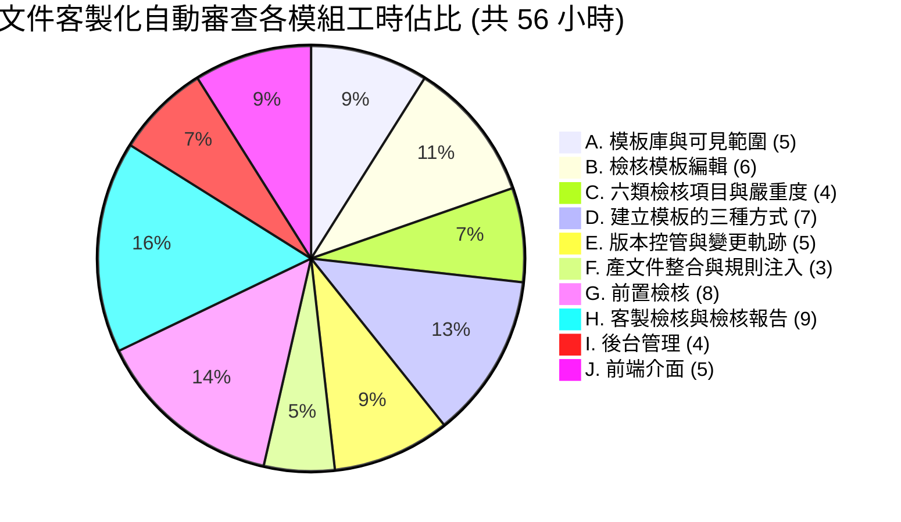
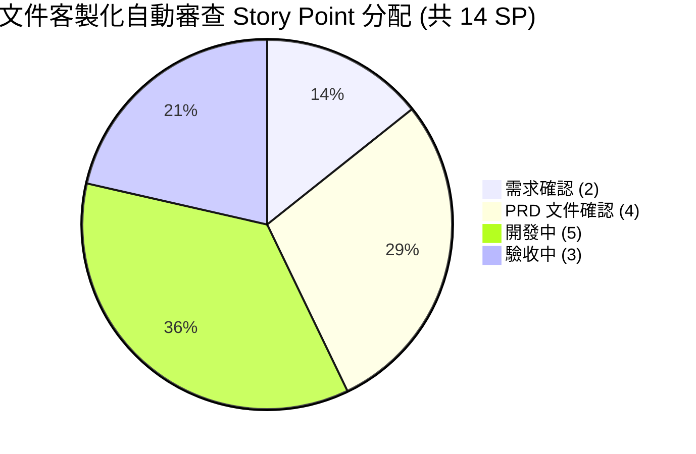

# AI Agents Office — 文件客製化自動審查 工時與 Story Point 估算

本文件為《[PRD-doc-review-client.md](PRD-doc-review-client.md)》文件客製化自動審查模組的工時與 Story Point 估算。本模組為 AI Agents Office 的擴充功能，讓各單位把自己的審查標準寫成「檢核模板」，在既有的防幻覺驗證之外，補上產出前的資料完整性檢核與產出後的單位自訂規則檢核。

> 對應 PRD：PRD-doc-review-client.md（v1.1，2026-10-19，已依客戶回覆修訂）
> 本估算以 **PRD 第 6 節功能範圍** 與 **第 9 節使用限制** 為前提，不含 6.1.1 明列之「後續視使用狀況再開」三項。

---

## 一、技術模組

| 層級 | 技術 |
|------|------|
| **後端框架** | Express 5 + TypeScript |
| **前端框架** | Next.js 15 (App Router) + React 19 |
| **資料庫** | MySQL 8.x (mysql2/promise) |
| **檢核 AI 通道** | 沿用現有低成本 AI 通道（地端優先），純文字判讀不佔用產文件運算資源 |
| **認證與組織** | 沿用現有 JWT + AD SSO；模板範圍直接取自 AD 部門資料，不另建群組 |
| **檔案儲存** | 沿用現有沙箱、上傳限制與儲存配額（模板樣張比照辦理） |
| **既有可重用機制** | 資料真實性驗證（防幻覺）、來源資料擷取、文件段落結構、產出內容比對 |

---

## 二、核心功能模組 (10 大模組)

| 模組 | 複雜度 | 說明 |
|------|--------|------|
| **A. 模板庫與可見範圍** | 中高 | 以 AD 部門為範圍的模板庫、兩層可見範圍（僅自己／部門共用）切換、擁有者歸屬、停用而不刪除、複製為新模板 |
| **B. 檢核模板編輯** | 中高 | 模板欄位（名稱／文件格式擇一／說明）、模板樣張上傳與格式連動、產出指引、規則編輯器 |
| **C. 六類檢核項目與嚴重度** | 中 | 必要要素、章節架構、格式規則、專有名詞（正確詞↔誤植對照）、數值規則、自由描述規則；每條可設必要／建議 |
| **D. 建立模板的三種方式** | 高 | ① 從預設檢核項目勾選帶入 ② 上傳 1～3 份範例文件由 AI 提出建議規則、逐條確認修改 ③ 從零建立；三者可混用 |
| **E. 版本控管與變更軌跡** | 中高 | 每次修改產生新版本、規則前後差異比對、唯讀不可刪改的軌跡、還原舊版；移轉／可見範圍切換／停用啟用／跨部門複製一併入軌跡 |
| **F. 產文件整合與規則注入** | 中 | 輸入區新增「檢核模板」選擇器、依本次文件格式過濾選單、選定後輸出格式隨模板走、規則同步注入產文件指示 |
| **G. 前置檢核（產出前）** | 高 | 來源資料抽取、逐條判定有／疑似有／沒有並附判斷依據、缺料清單、補資料／標為不適用／略過繼續、補齊後重檢 |
| **H. 客製檢核與檢核報告（產出後）** | 高 | 缺漏／矛盾／誤植三類發現、標註定位到段落頁面、逐項確認或忽略並記錄處置人與時間、報告保存含當時模板版本 |
| **I. 後台管理（檢閱者）** | 中 | 預設檢核項目維護（新增／修改／停用）、全公司模板清單與使用狀況、擁有者移轉、跨部門代為複製 |
| **J. 前端介面** | 中高 | 模板庫列表、模板編輯器、缺料清單互動、檢核報告面板與段落跳轉 |

---

## 三、功能模組說明

### A. 模板庫與可見範圍
| 功能項目 | 說明 |
|----------|------|
| 部門範圍 | 模板庫以 AD 部門為範圍，成員只看得到自己的模板與所屬部門設為共用的模板 |
| 可見範圍切換 | 僅自己 ↔ 部門共用，隨時可切換，切換動作入變更軌跡 |
| 擁有者歸屬 | 建立者即擁有者；離職或轉調由檢閱者／管理員移轉，規則與歷史版本一併帶過去 |
| 停用與複製 | 模板可停用而不刪除（歷史檢核紀錄保留），也可複製後修改作為新模板起點 |
| 多模板並存 | 一人可建多組；一個模板對應一種報告類型與一種文件格式 |

### B. 檢核模板編輯
| 功能項目 | 說明 |
|----------|------|
| 基本欄位 | 模板名稱、文件格式（Word／簡報／Excel／PDF 擇一）、給成員看的用途說明 |
| 模板樣張 | 選填，上傳一份現有該格式文件；上傳後格式由檔案決定，並供 AI 參考版面與寫法 |
| 產出指引 | 選填，一段給 AI 的補充說明，產文件時一併注入 |
| 規則編輯器 | 多筆檢核項目的新增、排序、修改、刪除 |

### C. 六類檢核項目與嚴重度
| 功能項目 | 說明 |
|----------|------|
| 必要要素 | 名稱＋說明＋嚴重度，例如報價總金額、客戶全名、有效期限 |
| 章節架構 | 章節清單，可設定順序 |
| 格式規則 | 文字描述，例如金額加千分位、日期格式、幣別標示 |
| 專有名詞 | 正確詞 ↔ 錯誤寫法對照（可多筆），屬各部門模板內設定，不建中央詞庫 |
| 數值規則 | 規則描述，例如明細加總須等於總價、折扣上限、數量須為正整數 |
| 自由描述規則 | 一段自然語言，處理難以結構化的審查重點 |
| 嚴重度 | 必要（紅色醒目提示）／建議（黃色一般提示），皆不阻擋送出 |

### D. 建立模板的三種方式
| 功能項目 | 說明 |
|----------|------|
| ① 預設項目挑選 | 系統列出內建常見檢核項目供勾選帶入，帶入後即成為模板自有規則，與系統預設不再連動 |
| ② 範例文件自動產生 | 上傳 1～3 份過去同類文件，AI 讀完提出建議規則清單，建立者逐條確認、修改或刪除後存檔 |
| ③ 從零建立 | 直接新增規則 |
| 混用 | 三種方式可在同一模板內混用 |

> ② 的定位是「AI 出草稿、人來定稿」——未經建立者確認的規則不會生效，不會自動套用。

### E. 版本控管與變更軌跡
| 功能項目 | 說明 |
|----------|------|
| 版本快照 | 每次修改產生新版本，保留完整規則內容 |
| 差異比對 | 記錄誰、何時、改了哪一條規則（新增／修改／刪除），可比對前後差異 |
| 軌跡事件 | 擁有者移轉（含事由）、可見範圍切換、停用與啟用、還原舊版、後台跨部門複製 |
| 唯讀保證 | 軌跡不可刪改，供日後稽核「這份文件當時是誰的標準、由誰把關」 |
| 版本綁定 | 每份檢核報告記錄當時套用的模板版本，回頭稽核看到的是當時標準 |
| 還原 | 可檢視歷史版本並還原到指定舊版 |

### F. 產文件整合與規則注入
| 功能項目 | 說明 |
|----------|------|
| 模板選擇器 | 輸入區新增「檢核模板」選擇器，與現有「資料源」選擇器並列 |
| 格式過濾 | 選單只列出與本次文件格式相符的模板；選定後輸出格式隨模板走 |
| 規則注入 | 規則同時進入產文件指示，讓 AI 一開始就照規矩寫，降低事後抓錯機率 |
| 向下相容 | 不選模板時行為與現狀完全相同，不影響既有使用者 |

### G. 前置檢核（產出前）
| 功能項目 | 說明 |
|----------|------|
| 資料抽取 | 擷取上傳檔案內容與使用者輸入的需求文字 |
| 逐條判定 | AI 比對模板必要項目，判定有／疑似有／沒有，並附判斷依據（引用來源片段） |
| 缺料清單 | 以清單呈現，每項可補資料、標為不適用（記錄原因）、略過並繼續產出 |
| 重新檢核 | 補齊後重檢，通過即進入產文件 |

### H. 客製檢核與檢核報告（產出後）
| 功能項目 | 說明 |
|----------|------|
| 執行順序 | 先經現有資料真實性驗證（自動修正幻覺），再執行模板規則檢核 |
| 三類發現 | 缺漏（模板要求項目找不到）、矛盾（與來源不一致或來源互相矛盾）、誤植（名詞寫法、數值格式） |
| 段落定位 | 標註到對應段落／頁面，點擊跳到該處，沿用現有文件段落結構 |
| 處置紀錄 | 撰寫者標記已確認或忽略，記錄處置人與時間 |
| 不阻擋送出 | 即使「必要」項目未通過也不卡住送出，在文件旁明確提醒，由人決定 |
| 報告保存 | 保留使用的模板與版本、缺料清單、發現清單、處置狀態；跟著文件走，文件刪除時一併刪除 |

### I. 後台管理（檢閱者）
| 功能項目 | 說明 |
|----------|------|
| 預設項目維護 | 系統內建檢核項目的新增、修改、停用 |
| 全公司模板清單 | 檢視擁有者、部門、版本、使用次數，以便執行移轉與複製作業 |
| 擁有者移轉 | 人員離職或轉調時指定接手人，規則與歷史版本一併移轉 |
| 跨部門複製 | 複製整份模板（規則、嚴重度、產出指引、樣張與附件）至指定部門與接手人；一次性複製、不連動，複本標示來源 |

### J. 前端介面
| 功能項目 | 說明 |
|----------|------|
| 模板庫列表 | 我的模板與部門共用模板、狀態與版本標示、搜尋與篩選 |
| 模板編輯器 | 六類規則的表單化編輯、嚴重度設定、樣張上傳、版本與軌跡檢視 |
| 缺料清單 | 逐項補資料／標為不適用／略過的互動流程 |
| 檢核報告面板 | 三類發現分組呈現、嚴重度配色、點擊定位、確認／忽略操作 |

---

## 四、工時總計

### 工時分佈圖

| 模組 | 小時 |
|------|------|
| A. 模板庫與可見範圍 | 5 |
| B. 檢核模板編輯 | 6 |
| C. 六類檢核項目與嚴重度 | 4 |
| D. 建立模板的三種方式 | 7 |
| E. 版本控管與變更軌跡 | 5 |
| F. 產文件整合與規則注入 | 3 |
| G. 前置檢核 | 8 |
| H. 客製檢核與檢核報告 | 9 |
| I. 後台管理 | 4 |
| J. 前端介面 | 5 |
| **合計** | **56 小時** |

---

### 專案 Story Point 分配

本模組總計 **14 SP**（1 SP = NT$20,000，合計 NT$280,000），各階段分配如下：

| 階段 | SP | 佔比 | 說明 |
|------|:--:|------|------|
| 需求確認 | 2 | 14% | 痛點訪談、審查流程與使用情境定義、角色定位釐清（檢閱者＝應用管理者）、可見範圍層級確認 |
| PRD 文件確認 | 4 | 29% | PRD v1.0 撰寫與 v1.1 依客戶回覆修訂（角色權限、擁有者移轉入軌跡、預設項目維護開放、跨部門改由後台代為複製）；六類檢核項目與預設項目清單定義；與現有防幻覺機制的分工界定 |
| 開案確認 | 0 | 0% | — |
| 開發中 | 5 | 36% | 10 大模組開發：模板庫與編輯器、六類規則、三種建立方式、版本與軌跡、產文件整合、前置檢核、客製檢核與報告、後台管理、前端介面 |
| 驗收中 | 3 | 21% | 整合測試、檢核準確度驗證（誤報／漏報抽樣）、版本與軌跡稽核驗證、權限與可見範圍測試、UAT 與部署上線 |
| 已結案 | 0 | 0% | — |
| **合計** | **14** | **100%** | |

> **關於比例**：本模組「開發中」佔 36%，低於一般專案的 60%，「PRD 文件確認」則相對偏高。原因有二——① PRD 第 8 節所列的基礎能力（來源資料擷取、產出內容比對、段落定位、低成本 AI 通道）**現有系統都已具備**，本模組是在既有地基上擴充「規則可自訂」與「結果給人看」，而非從零建置；② 本模組的難處不在寫程式，而在**把各單位說不清楚的審查標準，收斂成可維護的規則結構**——六類檢核項目、嚴重度分級、預設項目清單、可見範圍與權限邊界，這些都在 PRD 階段定案，該階段的投入直接決定開發階段能不能一次做對。

---

## 五、交付項目

1. 檢核模板庫與編輯器（AD 部門範圍、兩層可見範圍、六類檢核項目、嚴重度分級）
2. 三種模板建立方式（預設項目挑選、範例文件 AI 產生建議規則、從零建立）
3. 模板版本控管與唯讀變更軌跡（含擁有者移轉、可見範圍切換、停用啟用、還原、跨部門複製）
4. 前置檢核（產出前缺料清單與補齊流程）
5. 客製檢核與檢核報告（三類發現、段落定位、確認／忽略處置紀錄、版本綁定保存）
6. 產文件流程整合（模板選擇器、格式過濾、規則注入產出指示）
7. 後台管理功能（預設檢核項目維護、全公司模板清單、擁有者移轉、跨部門代為複製）

---

## 六、估算前提與待確認事項

本估算以下列前提成立為準，若前提有變動，SP 須重新評估：

| # | 項目 | 本估算採用之前提 | 依據 |
|---|------|------------------|------|
| 1 | 系統角色 | **不新增任何角色**，沿用現有一般用戶／檢閱者／管理員三種 | PRD 5 |
| 2 | 單位範圍 | 直接沿用 AD 部門資料，不另建群組或自訂組織層級 | PRD 5、6.1 |
| 3 | 可見範圍 | **只有兩層**（僅自己／部門共用），使用者不能自行跨部門分享 | PRD 6.1 |
| 4 | 跨部門共用 | 由檢閱者／管理員在後台**代為複製**，一次性、不連動 | PRD 6.1.1 |
| 5 | 模板與格式 | 一個模板對應**一種**文件格式，不支援一模板多格式 | PRD 6.2 |
| 6 | 檢核 AI 通道 | 走現有低成本 AI 通道（地端優先），不另建模型或額外佔用產文件資源 | PRD 8 |
| 7 | 防幻覺驗證 | **維持不變**，本模組疊加於其後，不重寫、不取代 | PRD 2、8 |
| 8 | 阻擋行為 | 檢核結果**一律提示、不阻擋送出**，含標示為「必要」的項目 | PRD 1、6.7 |
| 9 | 專有名詞 | 各部門模板內設定，**不建跨系統中央詞庫** | PRD 7 |
| 10 | 資料量上限 | 沿用現行限制（單檔 20MB／最多 3 檔／總計 40MB／PDF 30 頁），檢核比對各取前約 4 萬字 | PRD 9 |
| 11 | 報告保存 | **跟著文件走**，文件刪除時一併刪除，不另設保存期限與封存機制 | PRD 6.8 |
| 12 | 檢核準確度 | AI 判讀可能誤報漏報，驗收以**抽樣檢視**為準，不以零誤報為驗收條件 | PRD 9 |

> 註：PRD 6.1.1 明列之「後續視使用狀況再開」三項——**使用者自助分享複本、公司參考範本庫、模板檔案匯出匯入**——**不在本 14 SP 估算內**，如需納入須另行評估。
>
> 註：PRD 9 所述之主觀性規則（「寫得好不好」）不在本模組範圍，本模組聚焦「有沒有、對不對、合不合規」。

---

*估算日期: 2026-10-20*
